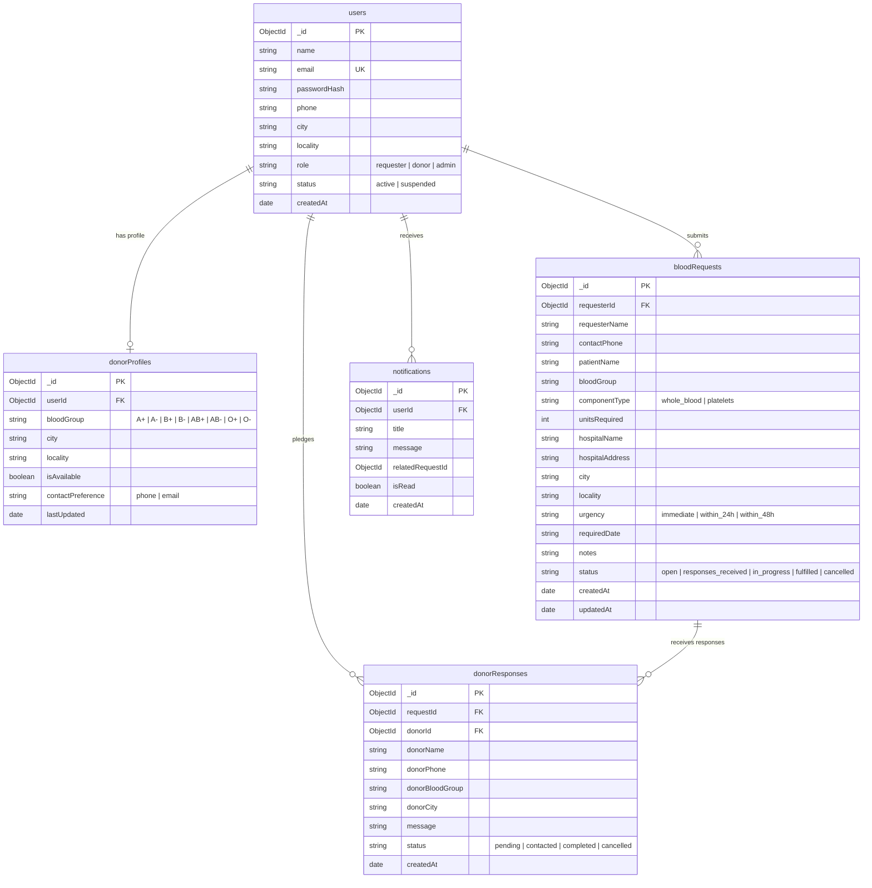

# 🩸 BloodLink — Emergency Blood & Platelet Coordination Platform

> **Course:** Full Stack Development (Course Code: 3CS524CC26)  
> **Type:** Innovative College Assignment / Laboratory Project  
> **Department:** Department of Computer Science & Engineering, Institute of Technology, Nirma University  

[](https://render.com/deploy?repo=https://github.com/Bhumik287/Bloodlink)

---

## 📋 1. Project Overview & Purpose

**BloodLink** is an educational, full-stack 3-tier web platform designed to streamline and accelerate the critical process of connecting patients in urgent need of blood or platelets with nearby voluntary donors. 

During acute medical emergencies (such as trauma surgeries, obstetric complications, or oncological treatments), families and relatives frequently lose valuable hours manually contacting hospital blood banks or broadcasting unstructured messages across social networks. BloodLink addresses this challenge by providing an organized, centralized coordination hub where:
1. **Requesters (Patients, Relatives, or Volunteers)** create structured emergency requirements specifying patient name, required blood group (A+, A-, B+, B-, AB+, AB-, O+, O-), component type (Whole Blood or Platelets), required units, hospital name, exact ward/location, and urgency level.
2. **Voluntary Donors** browse active local requests filtered by blood group and locality, and express immediate willingness to assist with a single click (*"I'm Available to Help"*).
3. **Direct Contact Coordination:** Requesters securely access contact information for responding donors in their private dashboard to coordinate arrival at the hospital blood bank.
4. **Responsible Use Principle:** BloodLink acts as a communication bridge. It clearly states across all pages that actual clinical eligibility, cross-matching, and donation suitability are strictly screened and confirmed by qualified hospital medical professionals.

---

## 🏛️ 2. 3-Tier Architecture & Syllabus Mapping

The platform demonstrates direct practical application of the concepts taught across **Units 1 through 5** of the course syllabus:

```
┌────────────────────────────────────────────────────────────────────────┐
│               TIER 1: PRESENTATION LAYER (Units 1 & 2 - MERN)          │
│  • React 18 Single Page Application (SPA): UI Components, JSX, Props   │
│  • Fundamental State Management (`useState`), Lifecycle & Fetch (`useEffect`)│
│  • Bootstrap 5.3 Responsive Grid System (.container, .row, .col-*)     │
│  • Tailwind CSS v3 + CSS3 Media Queries for Component Styling & Design │
│  • Authentic student-designed UI (clean, accessible, zero AI template) │
└───────────────────────────────────▲────────────────────────────────────┘
                                    │ HTTP / REST APIs (JSON)
┌───────────────────────────────────▼────────────────────────────────────┐
│              TIER 2: APPLICATION / BUSINESS LAYER (Units 3 & 5)        │
│  • Node.js runtime & Express.js web framework                          │
│  • Modular Routing: authRoutes, requestRoutes, donorRoutes, adminRoutes│
│  • Session Authentication & Role-Based Access Control (RBAC)           │
│  • Centralized Error-Handling Middleware & Input Validation            │
│  • Secure Password Hashing with bcryptjs (10 salt rounds)              │
└───────────────────────────────────▲────────────────────────────────────┘
                                    │ Native MongoDB Driver (MongoClient)
┌───────────────────────────────────▼────────────────────────────────────┐
│                  TIER 3: DATA LAYER (Units 1 & 4)                      │
│  • MongoDB Community Server (NoSQL Document Store)                     │
│  • Official native 'mongodb' package & MongoClient connection pool     │
│  • Collections: users, donorProfiles, bloodRequests, donorResponses,   │
│                 notifications                                          │
│  • Parameterized / Structured Query Objects & Unique Compound Indexes  │
└────────────────────────────────────────────────────────────────────────┘
```

| Course Unit | Syllabus Topics | Practical BloodLink Implementation |
| :--- | :--- | :--- |
| **Unit 1: Full Stack Basics** | 3-Tier Web Architecture, JSON exchange, Client-Server interactions | Clean separation of Presentation (React SPA in public static files), Logic (Express API server), and Data (MongoDB database). Complete MERN stack implementation exchanging JSON over HTTP REST endpoints. |
| **Unit 2: Frontend Frameworks** | Responsive Web Design, Bootstrap 5, Tailwind CSS, React JS: Elements, UI Components, JSX, Fetch Data | React 18 Single Page Application rendering functional UI components with `useState` and `useEffect` data fetching. Responsive layout handled by Bootstrap 5 Grid, with styling powered by Tailwind CSS v3 and custom media queries in `public/css/styles.css`. |
| **Unit 3: Backend Frameworks** | Node.js, Express.js routing (`express.Router`), middleware, static files, error handlers | Modular route handlers (`src/routes/`), centralized JSON error handling (`src/middleware/errorHandler.js`), and static asset serving. |
| **Unit 4: Database Integration** | NoSQL document stores, MongoDB native driver, `MongoClient`, CRUD operations, indexes | Direct database connection using official `mongodb` npm package without ORM/ODM abstractions. Persistent connection reuse via singleton pool in `src/config/db.js`. |
| **Unit 5: Application Security** | Authentication, password hashing, session cookies, route protection, environment config | Passwords hashed with `bcryptjs` (salt rounds: 10), HTTP-only session cookies via `express-session`, route guards (`requireAuth`, `requireAdmin`), and strict ownership validation. |

---

## 🗄️ 3. Database Schema Design (Native MongoDB)

The database `bloodlink_db` utilizes 5 dedicated collections:



### Key Database Constraints & Indexes
1. `users`: Unique index `{ email: 1 }` strictly rejects duplicate user accounts at the database level.
2. `donorProfiles`: Unique index `{ userId: 1 }` and compound index `{ bloodGroup: 1, city: 1, isAvailable: 1 }`.
3. `bloodRequests`: Compound index `{ status: 1, bloodGroup: 1, city: 1 }` optimizing multi-parameter emergency searches.
4. `donorResponses`: Compound unique index `{ requestId: 1, donorId: 1 }` preventing a donor from submitting duplicate active pledges to the same emergency request.
5. `notifications`: Index `{ userId: 1, createdAt: -1 }` for ordered retrieval of user alerts.

---

## 💻 4. Local Installation & Setup Instructions

### Prerequisites
1. **Node.js** (v18.x or v20.x or v24.x LTS installed): Check with `node -v`
2. **MongoDB Community Server** installed and running on `mongodb://127.0.0.1:27017`

### Step-by-Step Execution
1. Open PowerShell or Command Prompt and navigate to the project directory:
   ```powershell
   cd c:\Users\dell6\OneDrive\Desktop\fsd_inv_fin
   ```

2. Install dependencies:
   ```powershell
   npm install
   ```

3. Initialize environment variables configuration:
   ```powershell
   copy .env.example .env
   ```

4. Initialize the database collections, indexes, and demonstration accounts:
   ```powershell
   npm run db:init
   ```

5. Start the Express server:
   ```powershell
   npm start
   ```
   *(Or in development mode with automatic reload: `npm run dev`)*

6. Open your web browser and navigate to:
   ```
   http://localhost:5000
   ```

---

## 🔑 5. Pre-Seeded Demonstration Accounts (For College Viva)

For fast, effortless evaluation during your viva examination or presentation, the database comes pre-seeded with 3 standard test accounts. You can type them manually or click the **Demo Quick Fill** buttons on the Login page:

| Role | Email Address | Password | Intended Evaluation Workflow |
| :--- | :--- | :--- | :--- |
| **Requester** | `requester@example.com` | `Requester@123` | Create emergency blood requests, manage status transitions (`Open` $\rightarrow$ `Fulfilled`), view responding donors. |
| **Donor** | `donor@example.com` | `Donor@123` | Browse requests matching O+ blood group, click *"I'm Available to Help"*, toggle availability switch, view pledged responses. |
| **Administrator** | `admin@bloodlink.org` | `Admin@BloodLink2026` | View system overview metrics, manage users (activate/suspend), moderate or delete inappropriate requests. |

---

## 📡 6. Complete REST API Endpoint Reference

### Authentication (`/api/auth`)
| Method | Endpoint | Description | Access |
| :--- | :--- | :--- | :--- |
| `POST` | `/api/auth/register` | Register new user account (`requester` or `donor`) | Public |
| `POST` | `/api/auth/login` | Authenticate user credentials and establish session | Public |
| `POST` | `/api/auth/logout` | Terminate session and clear session cookie | Logged In |
| `GET` | `/api/auth/me` | Retrieve currently authenticated session user | Logged In |

### Blood Requests (`/api/requests`)
| Method | Endpoint | Description | Access |
| :--- | :--- | :--- | :--- |
| `GET` | `/api/requests` | Search and filter open emergency blood requests | Public |
| `GET` | `/api/requests/stats` | Aggregated live database counters for home page | Public |
| `GET` | `/api/requests/my` | Retrieve requests submitted by the logged-in requester | Requester / Admin |
| `GET` | `/api/requests/:id` | Retrieve full clinical and hospital details of a request | Public |
| `POST` | `/api/requests` | Submit a new emergency blood or platelet request | Public / User |
| `PUT` | `/api/requests/:id/status` | Update request coordination status (`fulfilled` / `cancelled`) | Request Owner / Admin |
| `POST` | `/api/requests/:id/respond` | Express donor availability pledge (*"I'm Available to Help"*) | Donor / Admin |
| `GET` | `/api/requests/:id/responses`| Retrieve donor responses and phone numbers for a request | Request Owner / Admin |
| `GET` | `/api/requests/notifications`| Fetch in-app notifications for the user | Logged In |
| `PUT` | `/api/requests/notifications/read`| Mark in-app notifications as read | Logged In |

### Donor Management (`/api/donors`)
| Method | Endpoint | Description | Access |
| :--- | :--- | :--- | :--- |
| `GET` | `/api/donors/profile` | Retrieve donor blood group and availability status | Donor / Admin |
| `PUT` | `/api/donors/profile` | Update donor blood group and toggle availability switch | Donor / Admin |
| `GET` | `/api/donors/my-responses`| Retrieve all donation pledges made by the donor | Donor / Admin |
| `DELETE`| `/api/donors/responses/:id`| Cancel an active donation pledge | Response Owner / Admin |

### Administrator Moderation (`/api/admin`)
| Method | Endpoint | Description | Access |
| :--- | :--- | :--- | :--- |
| `GET` | `/api/admin/overview` | Retrieve system metrics, all requests, and users | Administrator Only |
| `PUT` | `/api/admin/requests/:id/status` | Override and update request status | Administrator Only |
| `DELETE`| `/api/admin/requests/:id` | Delete an inappropriate or spam blood request | Administrator Only |
| `PUT` | `/api/admin/users/:id/status` | Suspend or activate a user account | Administrator Only |

---

## 🧪 7. Automated Test Suite

BloodLink includes a comprehensive automated test suite covering all phases and full end-to-end user journeys:

### Run Master End-to-End Test Suite:
```powershell
npm test
```
*Executes the complete multi-user lifecycle from registration, emergency request posting, search filtering, donor response, duplicate rejection, requester phone retrieval, fulfillment, and admin oversight.*

### Run All Phase Test Suites Consecutively:
```powershell
npm run test:all
```
*Runs all 9 test suites (Phases 1 through 8 + Master E2E) executing **126 automated checks with 100% pass rate**.*

---


## 📄 8. Educational Disclaimer
BloodLink is developed strictly as a college innovative assignment. It is designed to facilitate community communication between willing donors and patients. It does **not** perform medical diagnostic testing, guarantee blood supply, or substitute for certified hospital blood transfusion services.
